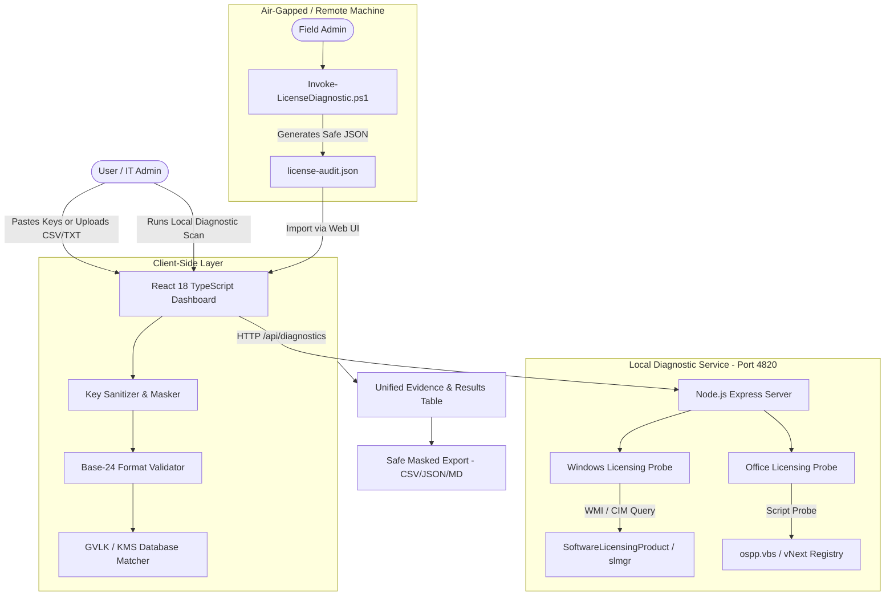

# Technical Architecture — Microsoft License Inspector

## 1. System Overview
**Microsoft License Inspector** is an enterprise-focused diagnostic system composed of three tightly coupled modules:
1. **Interactive Web Dashboard**: A high-performance React + TypeScript SPA for bulk key ingestion, format verification, filtering, and visual reporting.
2. **Local Node.js Diagnostic Engine**: A local REST API service executing authenticated, read-only Windows licensing queries (`Get-CimInstance SoftwareLicensingProduct`, `slmgr.vbs /dli`, `ospp.vbs /dstatus`) with process sandboxing.
3. **Standalone Offline PowerShell Agent (`Invoke-LicenseDiagnostic.ps1`)**: A portable script for field technicians to audit air-gapped or remote endpoints and export standardized diagnostic JSON schemas.

## 2. Tech Stack & Dependencies
- **Frontend**:
  - React 18, TypeScript 5+
  - Vite (Fast development and modern bundling)
  - Tailwind CSS (Fluent & Slate design system tokens)
  - Lucide React (Enterprise system icons)
- **Backend / Local Agent**:
  - Node.js (v18+)
  - Express.js (Lightweight, local loopback-only API server on `127.0.0.1:4820`)
  - `child_process` with strict argument whitelisting and timeout safeguards
- **System Automation**:
  - Windows PowerShell 5.1 / PowerShell 7+
  - Microsoft CIM / WMI (`SoftwareLicensingProduct`, `SoftwareLicensingService`)
  - VBScript engines for `slmgr.vbs` and `ospp.vbs` (in read-only query mode)

## 3. Data Flow & Security Boundaries
1. **Input Ingestion**:
   - Keys are stripped of whitespace and invalid separators.
   - Every key is assigned an in-memory UUID and a masked representation (`XXXXX-*****-*****-*****-XXXXX`).
   - Raw keys are NEVER written to disk, databases, or terminal logs.
2. **Format & Product Category Identification**:
   - Tested against Microsoft 5x5 regex: `^[BCDFGHJKMPQRTVWXY2346789]{5}(-[BCDFGHJKMPQRTVWXY2346789]{5}){4}$`.
   - Compared against known Microsoft KMS Setup / GVLK tables.
   - If key matches a known GVLK, product edition is identified with 100% certainty as a Volume KMS Client key.
   - If not matched to GVLK, product family is classified based on format with status `FORMAT_VALID` and validation note indicating activation cannot be inferred from key alone.
3. **Host Device Diagnostic Flow**:
   - Admin clicks "Inspect This Device".
   - API calls `Get-CimInstance SoftwareLicensingProduct` filtering by `PartialProductKey is not null`.
   - Retrieves active OS license, status (Licensed = 1, etc.), channel (OEM, Retail, Volume), and grace period.
   - Queries Office locations in `Program Files\Microsoft Office` and `Program Files (x86)\Microsoft Office`. Runs `cscript //nologo ospp.vbs /dstatus` if installed.
   - Returns structured evidence payload to the frontend.

## 4. Failure Modes & Graceful Degradation
- **Non-Windows Environments**: When run on Linux/macOS or without administrative privileges, local diagnostic tabs gracefully disable probe buttons and display instructions to upload an offline JSON report generated by `Invoke-LicenseDiagnostic.ps1`.
- **UAC Elevation Limits**: Standard non-elevated user queries use CIM queries which succeed for read-only license inspection without UAC elevation.
- **Missing Office Installations**: If `ospp.vbs` is not detected, the diagnostic engine scans for Click-to-Run Registry keys; if neither exists, reports `OFFICE_NOT_INSTALLED` without throwing errors.
