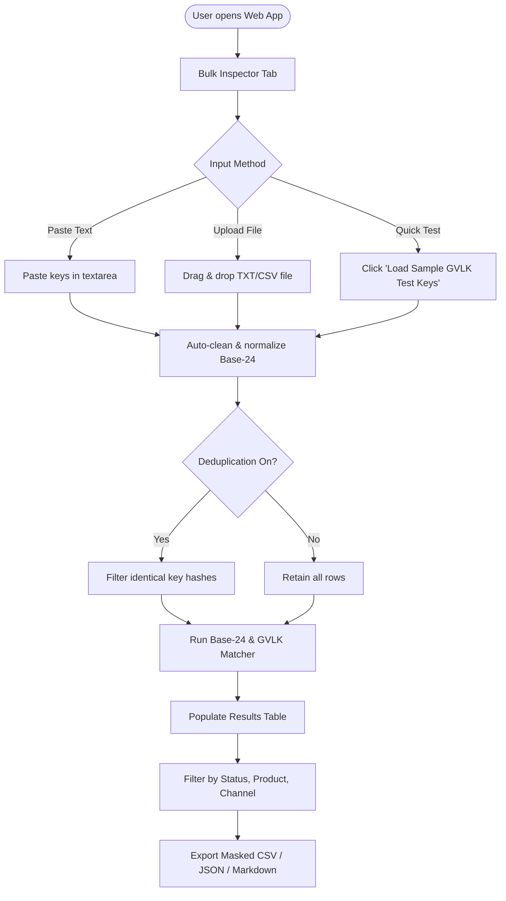
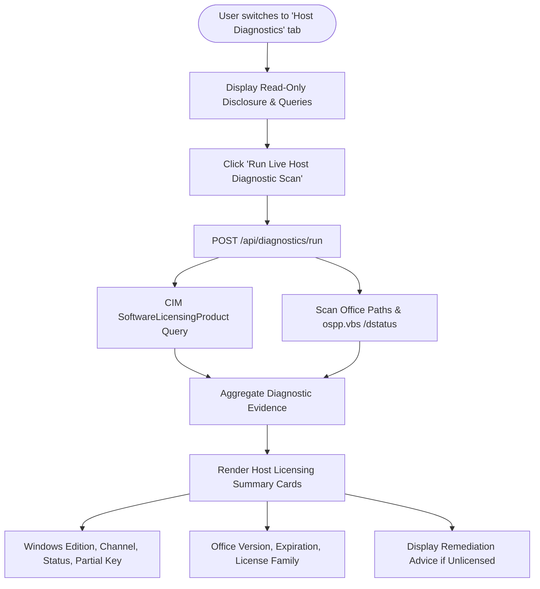
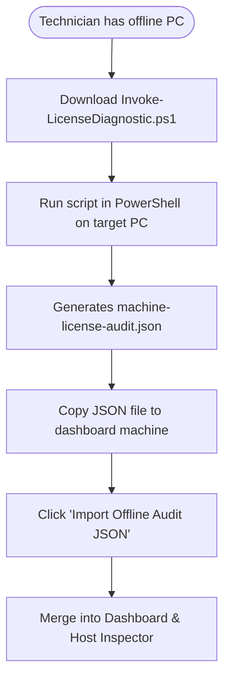

# User Experience Flows — Microsoft License Inspector

## 1. Primary User Journeys

### Flow 1: Bulk Key Parsing & Format Analysis

### Flow 2: Host Machine Licensing Diagnostics

### Flow 3: Offline Machine Inspection (Air-Gapped Systems)

## 2. Interface States

### 2.1 Empty States
- **Bulk Input Table**: Shows an empty-slate illustration with two prominent action pills: "Load Windows GVLK Demo Keys" and "Load Office KMS Demo Keys" to allow immediate evaluation without risking real private keys.
- **Host Diagnostic Card**: Shows "No diagnostic scan performed yet. Click 'Run Live Host Diagnostic Scan' to query local licensing status safely."

### 2.2 Loading & In-Progress States
- **Processing Keys**: Progress bar indicating `Processed X of Y keys...` with an animated pulse indicator.
- **Running Host Probes**: Skeleton loaders for Windows and Office telemetry cards with real-time status messages: "Querying SoftwareLicensingProduct...", "Inspecting ospp.vbs status...".

### 2.3 Error States
- **Format Errors in Keys**: Highlighted in dark red with specific reason (e.g., "Contains forbidden character 'O' (did you mean digit 0?)", "Length is 24 characters, expected 25").
- **Backend Disconnected**: If the local Node server is not running, the dashboard shows a clear amber badge: "Local Diagnostic Engine Offline — Bulk validation operates purely in-browser. To enable host scans, start `npm run server`."

### 2.4 Success States
- Toast notifications on successful CSV export, JSON download, or key copy.
- Confirmation badge when 100% of keys pass structural validation.
